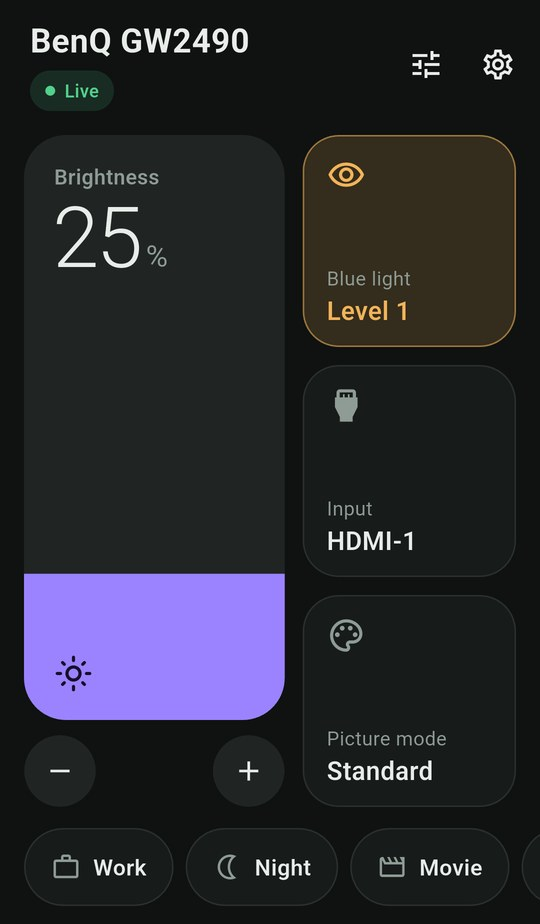

# Monitor Remote for Android

A phone remote for your monitor. It pairs with [BenQ Bridge](../README.md) on your PC and controls
any monitor that answers DDC/CI, not only BenQ ones. It talks to the same HTTP and WebSocket API as
the web page, so the PC side needs no changes.

<p align="center">
  
</p>

## What it does

One screen that fits without scrolling, built for a quick adjustment from the couch:

- **Brightness:** a tall fader. Drag up or down anywhere on it; it follows your finger instead of
  jumping, so it never changes by accident, and it ticks every 5%. − and + make single steps.
- **Blue light, input and picture mode:** a tile each, showing the current value. Tap a tile to
  pick from a sheet. Switching input offers **Undo**, because an empty port blacks out the screen.
- **Scenes:** pills along the bottom. Tap to apply, long-press to rename, update or delete, + to
  save the current settings. Scenes never touch the input source.
- **Instant start:** the last known values show at once while the app reconnects; controls wake up
  as soon as the PC answers.

Behind the gear: the paired PC, scenes, names for options (some picture modes only show up as codes
such as `0x0F`), every other setting, theme, and the factory reset behind a hold-to-confirm button.

## Install

Download the APK from the
[Android releases](https://github.com/samir-dahal/monitor-remote/releases?q=app-v&expanded=true)
(tags start with `app-v`) and open it on your phone. Android 7.0 or newer.

## Releases are built on GitHub

Releases are not built on a developer PC. Pushing a tag such as `app-v0.1.0` runs
[`.github/workflows/android-release.yml`](../.github/workflows/android-release.yml), which:

1. checks the tag matches `version:` in `pubspec.yaml`,
2. runs `flutter analyze` and `flutter test`,
3. builds the APK signed with the release key from the repository secrets,
4. refuses to publish if the APK is signed with a debug key,
5. publishes the APK and its SHA-256 as a release.

To release a new version: bump `version:` in `pubspec.yaml` and `appVersion` in
`lib/core/app_info.dart`, add a changelog entry, commit, then:

```powershell
git tag app-v0.2.0
git push origin app-v0.2.0
```

The signing key lives in four repository secrets: `ANDROID_KEYSTORE_BASE64`,
`ANDROID_KEYSTORE_PASSWORD`, `ANDROID_KEY_ALIAS` and `ANDROID_KEY_PASSWORD`. Keep a copy of the
keystore and its password somewhere safe: without them, a new release can't install over the old
one and everyone has to uninstall first.

## Develop

Flutter 3.41 or newer (Dart 3.11) and the Android SDK.

```powershell
cd app
flutter pub get
flutter run
flutter analyze
flutter test --coverage
```

The tests use an in-memory fake of the PC, so no monitor or network is needed. Local release
builds are signed with the debug key unless `android/key.properties` exists.

## How it is organised

```
lib/
  core/    theme, app name and version, BridgeScope (makes the controller available to screens)
  data/    models, the HTTP/WebSocket client, pairing-link parsing, local storage
  state/   BridgeController (connection, writes, scenes, names, theme) and Scene
  ui/      the remote screen, pairing, settings pages and the widgets they share
```

- `BridgeController` is the single source of truth. Screens read it through `BridgeScope`.
- Writes show immediately, collapse to the newest value while a request is in flight, and go out
  in order per control. A control being dragged is not moved by updates from the PC.
- The connection retries with a growing delay. A rejected token stops the retrying and asks to
  pair again.
- The access token is kept in the Android Keystore through `flutter_secure_storage`.

## Plain HTTP

BenQ Bridge serves plain HTTP on the local network, and Android blocks that by default. Its
network security config can only allow cleartext per domain name, not per IP range, so
`android/app/src/main/res/xml/network_security_config.xml` allows it for the whole app. Everything
the app talks to is a PC you paired with by QR code. The token travels unencrypted on your Wi-Fi,
the same as with the web page.

## Not in this version

- Home-screen widgets and a Quick Settings tile
- Finding the PC automatically (you pair by QR code or address)
- More than one saved PC
- iOS (building for iPhone needs a Mac)
